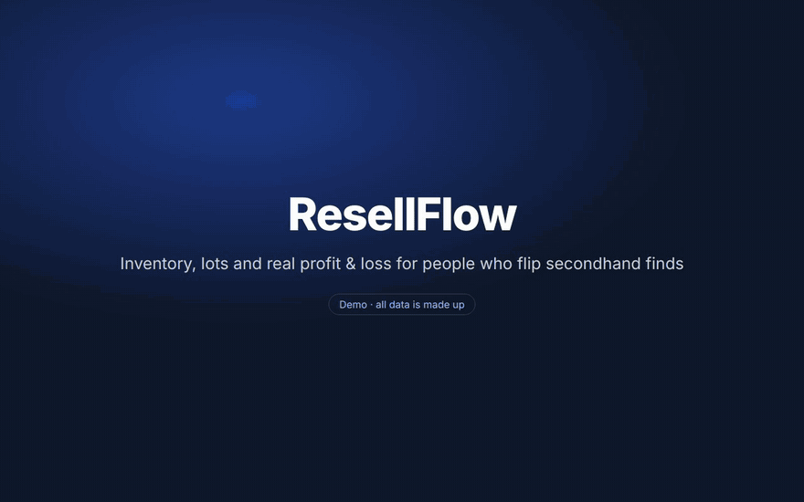

# ResellFlow

**[Overview](docs/OVERVIEW.md)** · **[User guide](docs/USER-GUIDE.md)** · [Quick start](#quick-start) ·
[Hosting on a NAS](docs/DEPLOY-NAS.md) · [Security & privacy](#security--privacy) · [How the money math works](#how-the-money-math-works) ·
[Common commands](#common-commands)

[](docs/demo/resellflow-demo.mp4)

<sub>▶ **[Watch the full-quality demo video (MP4, ~90s)](docs/demo/resellflow-demo.mp4)** · all data shown is made up</sub>

Inventory, lot tracking, and profit/loss for resellers who buy at garage sales,
thrift stores, estate sales, and Book Off — and flip on eBay, Mercari, and
Facebook. Built to solve the things a spreadsheet can't:

- **Lots that get broken up.** A lot's cost is split across its items
  automatically (proportional to each item's sale price). An item's profit always
  rolls back to the lot it came from — even when sold on its own or **bundled with
  items from a different lot**.
- **Fair bundle sales.** Sell several items for one total and the price is split
  by what each item cost you, so a $1 item in a $500 bundle shows the bundle's
  real return instead of an inflated ROI. A one-time review screen converts past
  multi-item sales.
- **Real P&L.** Gross, fees (eBay / Mercari / ad / shipping), net, and ROI — at
  the item, lot, and portfolio level, with monthly charts.
- **Good-deal checker.** Yen↔USD converter (your own rate, or fetched if you opt
  in) plus a verdict on whether you're
  over/underpaying, based on your own sale history or a comp you paste in.
- **Buy-more insights.** Ranks what you should source more of by a blended score,
  with toggles to view by total profit, ROI, or how often it sells. Bundle sales
  are tagged, an **Individual only** filter leaves them out, and ROI needs 3+ sales
  before it can top the rankings.
- **Barcode / SKU grouping + camera scanning.** Scan a barcode with your phone
  camera (or type it) to tag any item; items sharing a code are treated as one
  product so the "times sold" count is accurate even when names differ. Scan on
  the add-item form, the item editor, or the Deal Checker (scan in-store to pull
  up your history). Optional online name lookup for unknown barcodes (Settings,
  off by default). **Camera needs HTTPS or localhost** (browser requirement).
- **General ledger.** Record business expenses that aren't item purchases —
  import fees, commissions, supplies — and attach them to a lot, item, or sale (or
  leave them general). They reduce net and count toward ROI like fees.
- **Sortable, filterable tables** everywhere, defaulting to the relevant date
  (sold date for Sales, added date for Inventory, purchase date for Lots).
- **Per-item profit breakdown.** Click any item for its own page: gross, each fee
  (shipping / eBay / Mercari / ad), each attributed expense by name, cost of
  goods, and net — split correctly when sold in a multi-item bundle.
- **Item photos.** Upload multiple photos per item (or snap one on your phone);
  auto-thumbnailed for fast lists, stored in the uploads data folder, served only to
  the owner.
- **Smart barcode naming.** Scanning looks the code up across your own catalog
  first (instant, private, learns over time), then OpenLibrary (books/manga),
  MusicBrainz (CDs), and UPCitemdb (retail). External sources are opt-in.
- **CSV export & import.** Export inventory, sales, lots, or expenses to CSV;
  bulk-import inventory and sales (additive — never overwrites). In Settings.
- **Multi-user & self-hostable.** Invite-only accounts, each user's data private,
  all in one `docker compose`.

## Documentation

| Doc | What's in it |
|---|---|
| [Overview](docs/OVERVIEW.md) | What the app does, page by page, with screenshots (demo data) |
| [Demo video](docs/demo/resellflow-demo.mp4) | A 90-second walkthrough of the main features (demo data) |
| [User guide](docs/USER-GUIDE.md) | Step by step: first login, adding items and lots, sales, expenses, the dashboard, Deal Checker, backups |
| [Quick start](#quick-start) | Run it locally with Docker in a few minutes |
| [Hosting on a NAS](docs/DEPLOY-NAS.md) | Synology / QNAP / UGREEN / Unraid setup, HTTPS for the phone camera, backups, updates |
| [Security & privacy](#security--privacy) | What leaves your server (nothing, by default), who can reach the app, and how it's protected |
| [Passwords & lockout](docs/DEPLOY-NAS.md#9-passwords--lockout) | Changing your password, and resetting it from the server if you're locked out |
| [Inviting family & friends](#inviting-family--friends) | Invite-only accounts with private data per user |
| [Importing your existing data](#importing-your-existing-data) | CSV import and backup restore |
| [How the money math works](#how-the-money-math-works) | How lot costs, fees and ROI are calculated |

## Quick start

You only need **Docker** installed.

```bash
cp .env.example .env
# edit .env: set a strong POSTGRES_PASSWORD and your ADMIN_EMAIL / ADMIN_PASSWORD
# (12+ characters; the stack won't start while ADMIN_PASSWORD is blank or an
# example value). AUTH_SECRET is generated for you on first boot.
# APPDATA=./dev-data is already set for local use

docker compose up -d --build
```

Open <http://localhost:3939> (or whatever `APP_PORT` is) and sign in with the
`ADMIN_EMAIL` / `ADMIN_PASSWORD` you set. The database schema and the admin
account are created automatically on first boot.

By default the app only answers on the computer running it, so nobody else on
your Wi-Fi can reach the login page. To open it from other devices by IP (a NAS,
or your phone on the same network), set `APP_BIND=0.0.0.0` in `.env` and run
`docker compose up -d` again.

See [Security & privacy](#security--privacy) for what the app sends out (nothing,
by default) and how it's locked down.

### Where the data lives

Data is kept in plain folders outside the containers, under `APPDATA` from `.env`
(required — compose refuses to start without it):

| Folder | Mounted at | Contents |
|---|---|---|
| `$APPDATA/reselling-app/postgres` | `db:/var/lib/postgresql/data` | Postgres database (in `pgdata/`) |
| `$APPDATA/reselling-app/uploads` | `app:/app/uploads` | Item photos |
| `$APPDATA/reselling-app/secrets` | `app:/app/secrets` | Generated `AUTH_SECRET` (keep private) |
| `$APPDATA/reselling-app/tailscale` | `tailscale:/var/lib/tailscale` | Tailscale state (`ts` profile only) |

Locally `APPDATA=./dev-data` (git-ignored). On the NAS it's
`/volume1/docker/appdata` — see [Hosting on a NAS](docs/DEPLOY-NAS.md).

### Important: keep `DATABASE_URL` and `POSTGRES_*` in sync

`DATABASE_URL` (used by the app) must contain the same user/password/db as the
`POSTGRES_*` values (used by the database). The default `.env.example` already
lines them up — just change the password in both places.

### Updates that change the database

On every start the app brings the database up to date with the code. Changes
that only **add** things (new tables, new settings with defaults) apply on their
own. If an update would **delete** data — say a column is removed — the app
refuses, leaves the database untouched, and stops with this in
`docker compose logs app`:

```
  ✗ Database update stopped - nothing was changed (see the error above).
```

Nothing is lost at that point. To go ahead once you've read what it would drop:

```bash
docker compose exec -T db pg_dump -U resell -d resellflow > resellflow-before-update.sql  # back up first
docker compose run --rm app node_modules/.bin/prisma db push --skip-generate --accept-data-loss  # apply it
docker compose up -d                                                                      # start normally
```

Or roll back the code (`git checkout <previous version>`) and rebuild.

## Security & privacy

**Nothing leaves your server unless you turn it on.** Two per-account settings
reach outside services, and both are off by default:

| Setting | Sends | To |
|---|---|---|
| *Fetch today's rate automatically* | A request for the USD/JPY rate (no data of yours), about hourly | open.er-api.com |
| *Look up unknown barcodes online* | The scanned barcode, for codes not already in your catalog | OpenLibrary, MusicBrainz, UPCitemdb |

An admin can block rate fetching for everyone with `FX_API_URL=` (empty) in
`.env`. Next.js and Prisma telemetry are disabled in the Docker image. Every
outside service sees your server's IP address when it's used.

That's while the app runs. **Building** it (`docker compose up --build`) downloads
the usual software: Docker images, Debian packages, npm packages, and Prisma's
database engine from `binaries.prisma.sh`. No data of yours is involved.

**Who can reach it.** Only the computer running it, unless `APP_BIND=0.0.0.0`
opens the port to your network. The optional Caddy HTTPS profile (`--profile
https`) is the exception: it always publishes ports 80 and 443 on **every**
network interface, whatever `APP_BIND` says — that's how phones on your Wi-Fi
reach it. For use away from home, prefer Tailscale (the `ts` profile) to
forwarding a port on your router — the app isn't meant to face the open internet.

**How it's protected:**

- Login sessions are signed with `AUTH_SECRET` (generated per install; example
  placeholders and short secrets are refused). *Settings → Account → Sign out of
  all devices* revokes every session for an account.
- 10 wrong passwords pauses sign-in for that account for 15 minutes, however the
  email is spelled. Browsers that have signed in to the account before keep a
  separate budget, so someone hammering your account can't lock you out of your
  own devices. Behind your own reverse proxy, set `TRUST_PROXY=1` to also limit
  failures per client IP (see `.env.example` for when that's safe). Passwords are
  at least 12 characters and stored as bcrypt hashes; the first admin can't be
  created with an example password.
- Each user's records, photos and exports are only ever served to that user.
  Backup restores only touch the restoring user's own records and photos, are
  size-limited, and only accept photos in the app's own format.
- CSV exports neutralise spreadsheet formulas (`=`, `+`, `-`, `@`).
- Security headers block framing, content sniffing, and cross-site form posts
  to sign-in, sign-up and sign-out.
- The app container runs with a read-only filesystem, almost no Linux
  capabilities and no privilege escalation; updates never delete database data
  without you confirming it ([details](#updates-that-change-the-database)).

Found a problem? Open an issue on the repository (no exploit details in public,
please — say there's a security issue and how to reach you).

## Inviting family & friends

1. Sign in as admin → **Settings → Invites → Create invite**.
2. Share the link `https://your-host/register?code=THECODE`.
3. They create their own account; their inventory and P&L are completely private
   to them.

To let someone run their **own** copy instead, hand them this repo — the same
`docker compose up` gives them an independent instance.

## Importing your existing data

Use **Settings → Import** to bulk-import inventory and sales from CSV (download
the templates there for the exact columns), or restore a full ResellFlow backup
(`.json` or `.zip` with photos).

## How the money math works

- **Lot allocation:** `lot cost + tax` is split across the lot's items weighted by
  each item's sale price (falling back to estimated value, then an even split for
  unsold items). Set a **cost override** on any item to pin its share exactly.
  Prices that came from splitting a bundle total don't count as weights here (they
  were themselves derived from cost).
- **Bundle sales:** when a sale is entered as one total, the total is split across
  its items **by acquisition cost**, so every item shows the bundle's own ROI. A
  price you type on a line is kept, and the rest of the total splits around it.
  The bundle total is stored, so the split updates automatically when a cost
  changes later. Use **Sales → Review** to convert sales recorded before this.
- **Sale fees** are split across a sale's line items by sale price, then each
  item's net rolls up to its origin lot.
- **Personal belongings** (things you already owned, $0 cost) are flagged and
  tracked in a **separate bucket**. Their profit counts toward total net, but they
  are excluded from **Flip ROI** and per-item ROI — a return on a $0 cost basis is
  meaningless and would otherwise show up as a misleading "high ROI" winner.
- **Insights ROI guard:** a product needs **3 or more sales** before its ROI ranks
  in the ROI view, and ROI counts fully in the blended score only from 3 sales on —
  so one lucky sale can't make an item look like a top seller.
- All reporting is in **USD**. Each purchase also stores the yen amount and the
  locked exchange rate you paid; today's rate (your manual rate, or fetched if
  you opt in) is only used for the shopping calculator and yen display.
- Fee percentages are **editable** in Settings. Past sales keep the fees they were
  recorded with, so changing rates never rewrites history.

## Roadmap

- **Reports tab.** Planned: generated financial reports — P&L (profit & loss),
  net operating income, by-period / by-platform / by-source summaries, and
  export to PDF/CSV. Builds on the existing finance engine and ledger.

- **Real-time comps.** eBay/Mercari sold-price comps — deferred (eBay sold data
  is restricted/paid, Mercari has no public API). Currently uses your own sale
  history + manual comps.

- **HTTPS for phone camera.** Barcode scanning needs a secure context. For phone
  use, put the app behind a reverse proxy with TLS (Caddy/Traefik/nginx) or use a
  tunnel (Cloudflare Tunnel, Tailscale). On `localhost` it works as-is.

## Tech

Next.js 15 (App Router) · PostgreSQL · Prisma · Tailwind · Recharts. Auth is a
signed httpOnly session cookie (`jose` + `bcryptjs`). Installable as a PWA for
phone use while sourcing.

## Common commands

```bash
docker compose logs -f app        # tail app logs
docker compose down               # stop
git pull && docker compose up -d --build   # update: rebuild after pulling changes
```

Data lives in the `$APPDATA/reselling-app/` folders, so `docker compose down -v`
does **not** delete it. To wipe a local dev install, stop the stack and delete
`dev-data/`:

```bash
docker compose down && rm -rf dev-data   # DELETES local db + photos
```
