# ResellFlow — What It Does

ResellFlow is a self-hosted app for people who **buy secondhand and resell online**.
You might find things at thrift stores, estate sales, garage sales, flea markets or
Book Off, then sell them on eBay, Mercari or Facebook Marketplace. ResellFlow tracks
every item from the moment you buy it to the moment it sells, and tells you what you
actually made after fees, shipping and expenses.

It replaces the reseller spreadsheet. The spreadsheet's hardest problems are exactly
what ResellFlow handles automatically:

- **Lots that get broken up.** You pay $40 for a box of 6 things. What did each one cost?
- **Bundles.** One sale includes items from three different purchases.
- **Fees.** Every platform charges differently.
- **"Was that worth it?"** Answering it at the item, lot and business level.

> All screenshots below use **made-up demo data**.
> Ready to use it? The **[User guide](USER-GUIDE.md)** walks through every task step by step.

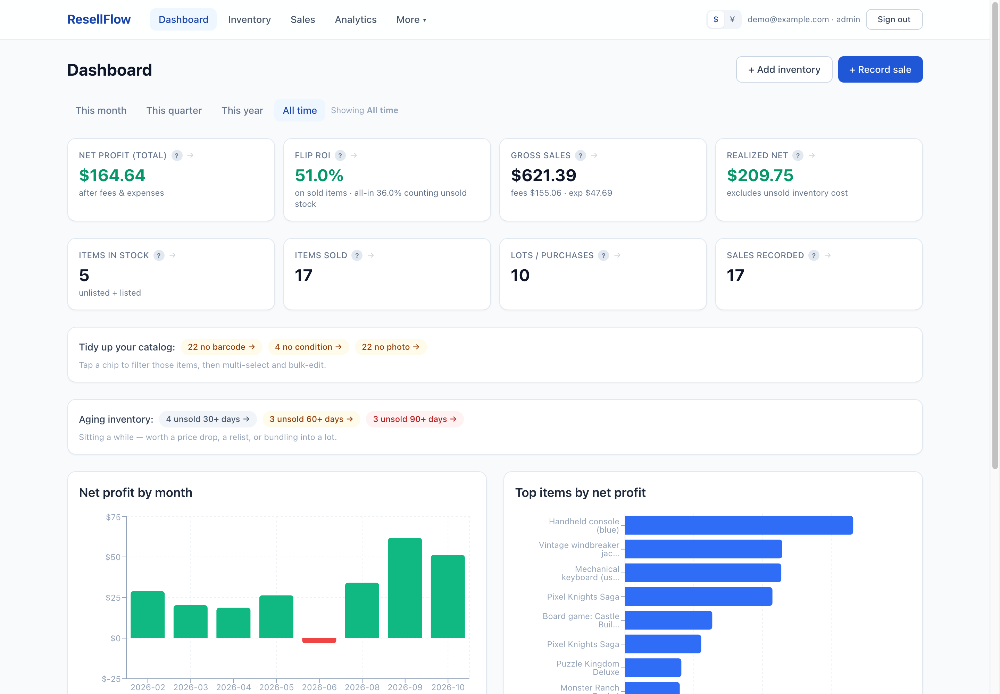

---

## The big picture

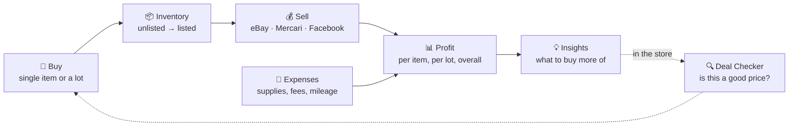

1. **Buy.** Log a single item, or a whole lot with many items in it.
2. **Stock.** Each item lives in your inventory with a status, a condition, photos and a barcode.
3. **Sell.** Record a sale (one item or a bundle). Platform fees are calculated for you.
4. **Measure.** The app splits costs and fees across items and rolls profit back to where each item came from.
5. **Learn.** Reports and insights show which sources, categories and products make you money.
6. **Shop smarter.** Next time you're in a store, scan a barcode and the Deal Checker tells you whether the price is worth it.

---

## Main areas of the app

### 📈 Dashboard

Your business at a glance, for this month, quarter, year or all time:

- Net profit, ROI, gross sales and realized net
- Items in stock, items sold, purchases and sales counts
- Net profit by month (chart) and your top items by profit
- **"Tidy up your catalog"**: items missing a barcode, condition or photo
- **Aging inventory**: items unsold for 30, 60 or 90+ days, a nudge to drop the price or relist

Every number can be clicked through to an **audit view** that shows exactly which items and
sales add up to it, so there are no mystery totals.

### 📦 Inventory

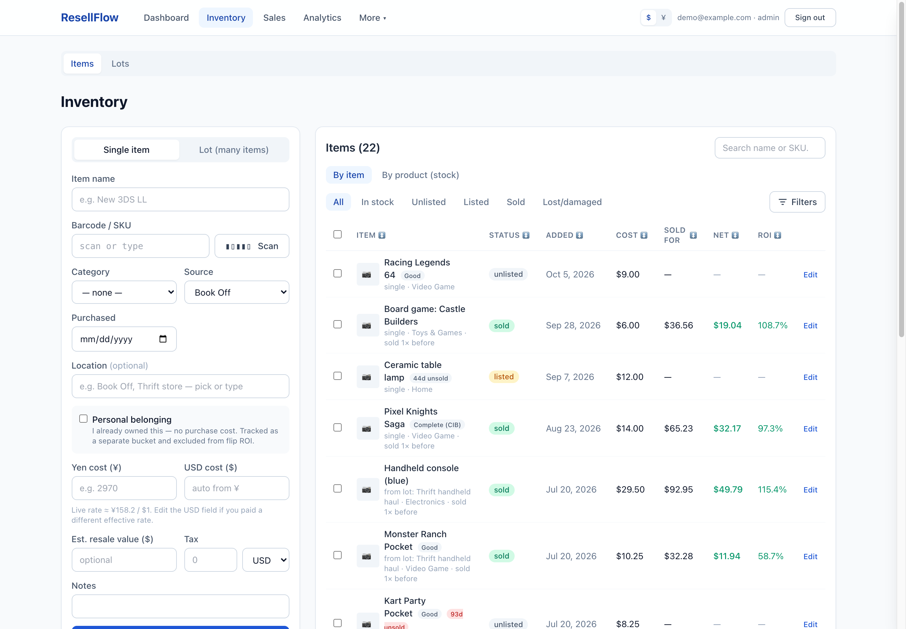

- **Add a single item or a lot.** Lots can be built one item at a time by scanning barcodes,
  or by pasting a list of names.
- Filter by status (unlisted, listed, sold, lost/damaged) and by category, condition, location and more
- View **by item** or **by product**. Items with the same barcode or name group together, so
  "times sold" stays accurate even if you named them slightly differently
- Multi-select and bulk-edit
- Each item gets its own page with photos and a **full profit breakdown**: sale price, each fee,
  attached expenses, cost of goods, and net

### 🧺 Lots & purchases

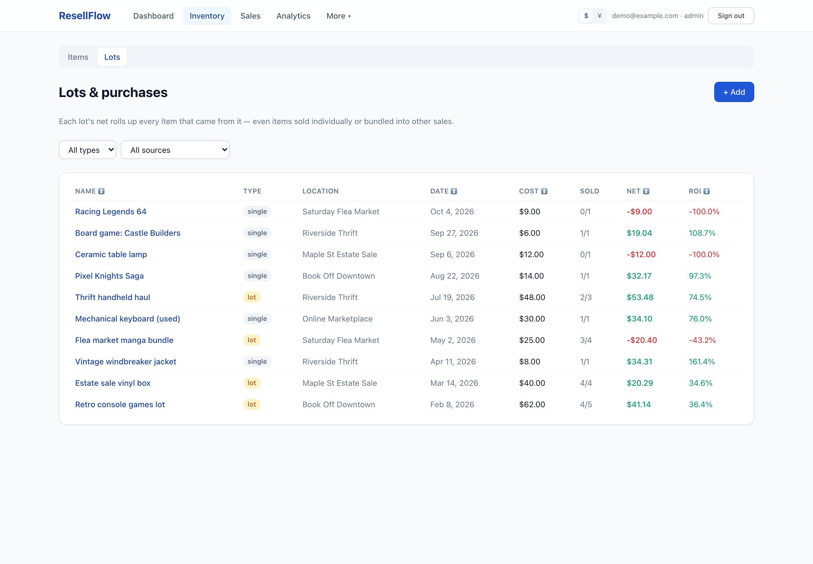

- Every purchase, whether a lot, a single item, or a **personal belonging** (something you already owned)
- A lot's cost (plus tax) is **split across its items automatically**, weighted by what each one
  sells for or is expected to sell for. You can pin any item's cost manually.
- See how each lot performed overall, even when its items sold separately or in bundles with other lots

### 💰 Sales

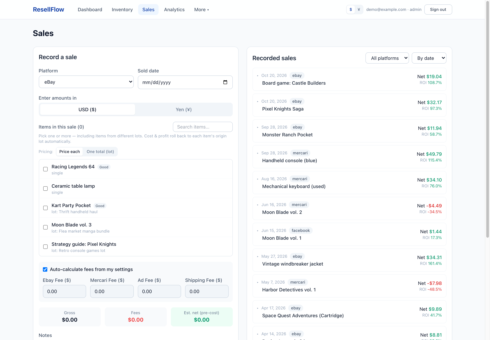

- Record a sale of one item or a **bundle** of several
- Pick the platform and the fees are **auto-calculated** from your fee settings (you can override them)
- Enter a single total for a bundle and it's split across the items by value
- Sort and filter by date, gross or net

### 📊 Analytics: Reports, Insights, Trends

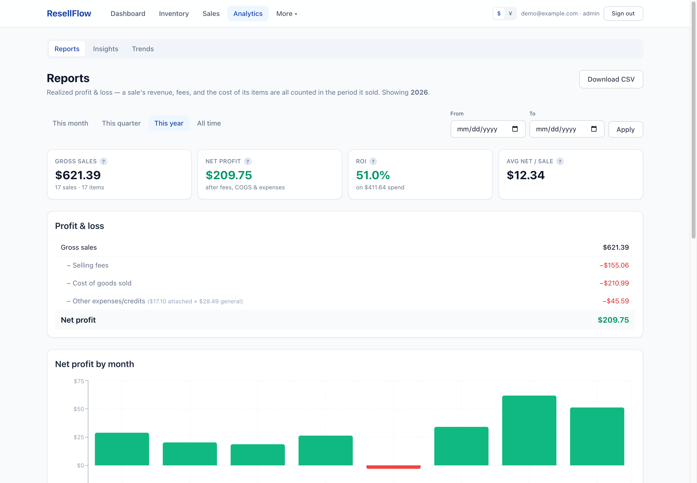

- **Reports**: profit & loss, net profit by month, and breakdowns by **sourcing location**,
  **platform**, **source type** and **expense category**
- **Insights: "what to buy more of."** Ranks products by a blended score, or by total profit,
  ROI, how often they sell, or how fast

  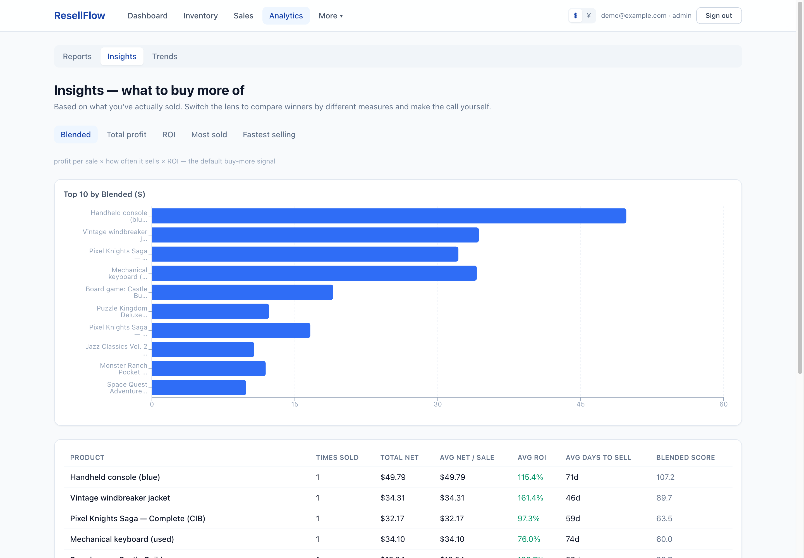

- **Trends: seasonality.** Which month each category sells best in, so you know what to stock when

  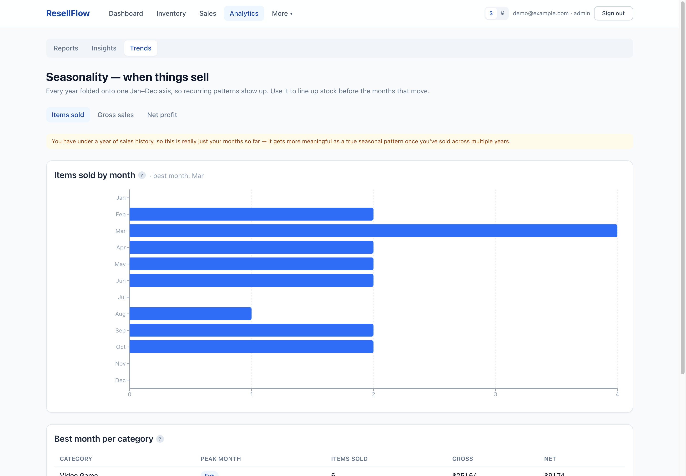

### 🔍 Deal Checker (for use in the store)

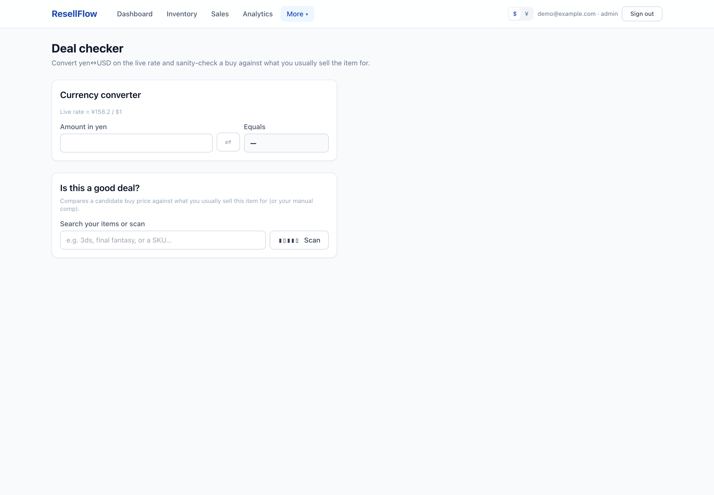

- Search or **scan a barcode with your phone camera**
- See your own history for that product: times sold, average sale price, and whether it's been
  selling above or below normal lately
- Enter the asking price (in **dollars or yen**) for a verdict from *"Buy it 🔥"* down to *"Rethink it"*,
  based on your real sale history or a comp price you paste in

### 🧾 General ledger

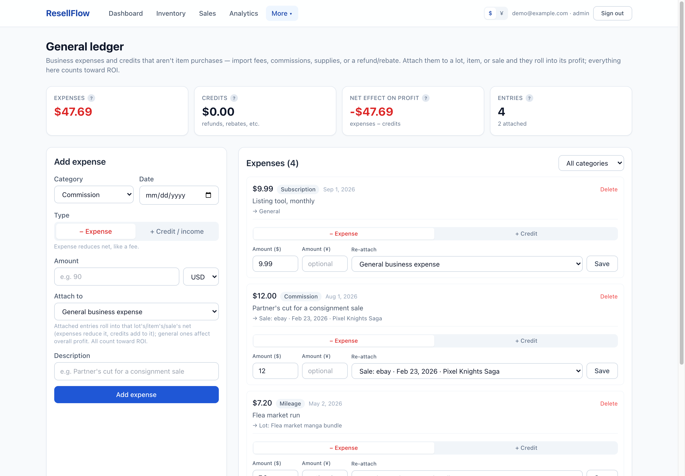

- Record business costs that aren't item purchases: supplies, shipping materials, subscriptions,
  mileage, import fees, a partner's commission
- Attach an expense to a lot, item or sale, or leave it general. Either way it counts against your profit.

### 📍 Locations

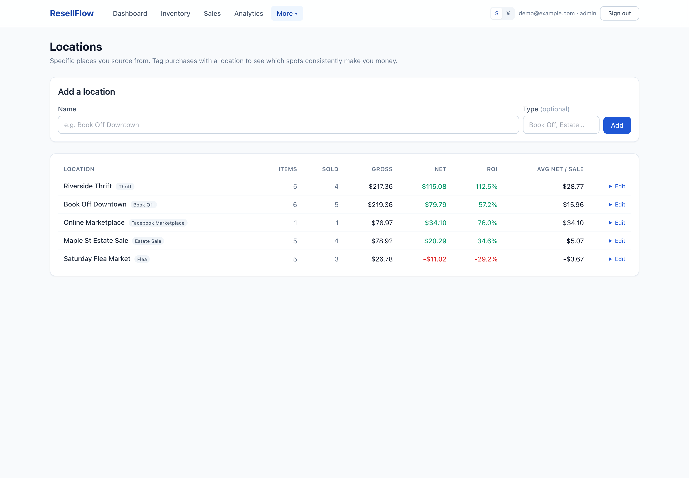

- Keep a list of the specific places you source from and see **which spots make you the most money**

### ⚙️ Settings

- **Fees**: eBay, Mercari, ad and default shipping rates (past sales keep the rates they were recorded with)
- **Display**: USD or yen, live or historical exchange rate, light/dark/off-white theme
- **Export & import**: CSV export of inventory, sales, lots and expenses; CSV import; full
  backup and restore (including photos)
- **Invites** (admin): registration is invite-only
- **Account**: change your password

---

## Things that make it different

| | |
|---|---|
| 🧮 **Honest profit math** | Lot costs and sale fees are split fairly across items; profit always rolls back to the lot it came from |
| 🎒 **Personal items tracked separately** | Things you already owned count toward profit but don't inflate your ROI |
| 💴 **Dollars and yen** | Built for buying in Japan: store the yen price and the exchange rate you actually paid |
| 📷 **Barcode scanning** | Scan with your phone camera to add items or check deals; optional name lookup from book, music and retail databases |
| 📱 **Works on your phone** | Installable as a phone app (PWA) for use while sourcing |

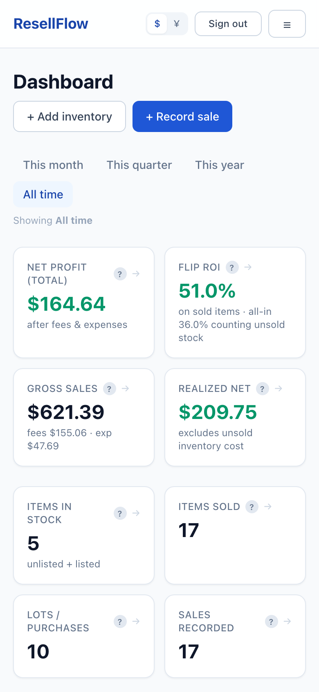

---

## Who it's for and how it runs

- **For** solo resellers, and family or friends who resell. Each person gets their own private
  account, and nobody can see anyone else's data.
- **Self-hosted.** It runs on your own computer or home NAS with one `docker compose` command.
  No subscription, and your data stays with you.
- **Built with** Next.js, PostgreSQL, Prisma, Tailwind and Recharts.

See the [User guide](USER-GUIDE.md) for step-by-step instructions, the [README](../README.md) for
setup, and [DEPLOY-NAS.md](../DEPLOY-NAS.md) for hosting on a NAS.
